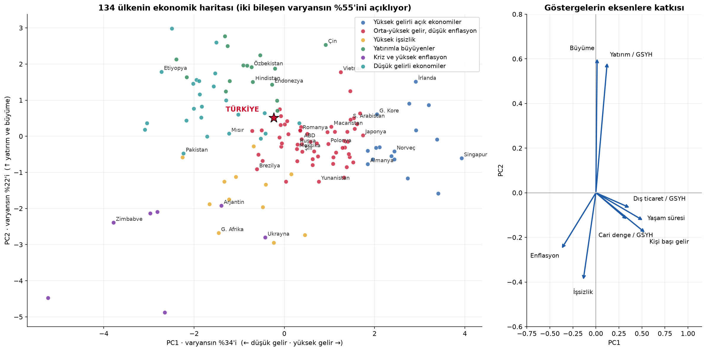
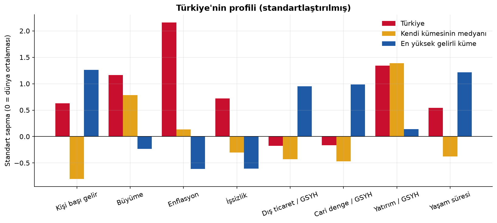
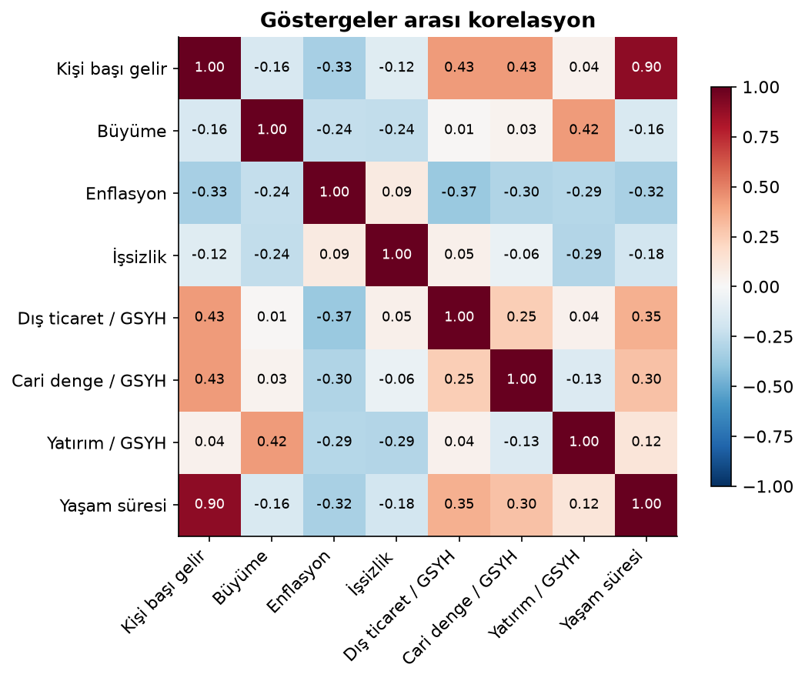
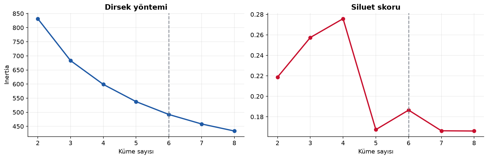

# 🌍 Ülke Ekonomilerini Kümeleme: Türkiye Kime Benziyor?


134 ülkeyi 8 ekonomik göstergeye göre **gözetimsiz öğrenme** ile gruplayan ve Türkiye'nin dünya ekonomisindeki yerini bulan bir veri bilimi projesi.

📓 **Analizin tamamı:** [`analiz.ipynb`](analiz.ipynb)

## Bulgular



| Küme | Ülke | Tanımlayıcı özellik | Örnekler |
|---|---|---|---|
| Yüksek gelirli açık ekonomiler | 17 | Gelir 64 bin $, dış ticaret GSYH'nin %128'i | Almanya, G. Kore, İsviçre, Singapur |
| Orta-yüksek gelir, düşük enflasyon | 57 | Gelir 31 bin $, enflasyon %4,7 | ABD, Japonya, Brezilya, Polonya |
| Yüksek işsizlik | 12 | İşsizlik %20,5 | G. Afrika, Irak, Tunus |
| **Yatırımla büyüyenler** | 17 | Yatırım GSYH'nin %34'ü, büyüme %4,2 | **Türkiye**, Çin, Hindistan, Endonezya |
| Kriz ve yüksek enflasyon | 7 | Enflasyon %70, küçülme | Arjantin, Ukrayna, Lübnan |
| Düşük gelirli ekonomiler | 24 | Gelir 3,5 bin $, yaşam süresi 64 yıl | Pakistan, Etiyopya, Kenya |

### Türkiye iki dünya arasında
- **Büyüme modeliyle** (yüksek yatırım, hızlı büyüme, cari açık) Çin, Hindistan ve Endonezya ile aynı kümede.
- **Geliri ve yaşam süresiyle** orta-yüksek gelirli ülkelere yakın: kişi başı geliri kümesinin medyanının yaklaşık 5 katı.
- **Onu ayıran şey enflasyon:** dünya ortalamasının 2,2 standart sapma üstünde.
- **En yakın komşular:** Özbekistan, Kazakistan, Gürcistan, Sırbistan, Romanya.



## Yöntem

1. **Veri:** Dünya Bankası'ndan 8 gösterge, 2019–2023 ortalaması. Nüfusu 1 milyonun altındaki ülkeler çıkarıldı.
2. **Ön işleme:** Çarpık dağılımlar için logaritma (gelir, dış ticaret) ve işaretli log dönüşümü (enflasyon); ardından standartlaştırma.
3. **Küme sayısı:** Dirsek yöntemi + siluet skoru + farklı bir algoritmayla (Ward) uyum. k = 6 seçildi; gerekçesi defterde.

$$s(i) = \frac{b(i) - a(i)}{\max\{a(i),\, b(i)\}}$$

4. **K-Means** (100 farklı başlangıç).
5. **PCA:** 8 boyut 2 boyuta indirgendi. Eksenler: *refah* (%34) ve *büyüme modeli* (%22).
6. **Benzerlik:** Standartlaştırılmış uzayda Öklid uzaklığıyla en yakın komşular.
7. **Sağlamlık:** Hiyerarşik kümeleme (Ward) ile karşılaştırma, Düzeltilmiş Rand İndeksi = 0,69.

 

## Göstergeler

| Gösterge | Dünya Bankası kodu |
|---|---|
| Kişi başı GSYH (satın alma gücü paritesi, sabit $) | `NY.GDP.PCAP.PP.KD` |
| Reel GSYH büyümesi | `NY.GDP.MKTP.KD.ZG` |
| TÜFE enflasyonu | `FP.CPI.TOTL.ZG` |
| İşsizlik (ILO) | `SL.UEM.TOTL.ZS` |
| Dış ticaret / GSYH | `NE.TRD.GNFS.ZS` |
| Cari denge / GSYH | `BN.CAB.XOKA.GD.ZS` |
| Brüt sermaye oluşumu / GSYH | `NE.GDI.TOTL.ZS` |
| Doğumda beklenen yaşam süresi | `SP.DYN.LE00.IN` |

Kaynak: [World Development Indicators](https://datatopics.worldbank.org/world-development-indicators/), CC BY 4.0.

## Çalıştırma

```bash
pip install -r requirements.txt
python -m src.veri           # (isteğe bağlı) veriyi yeniden çeker
jupyter notebook analiz.ipynb
```

## Sınırlılıklar

- Siluet skorları düşük: ekonomiler keskin gruplar değil, sürekli bir yelpaze oluşturuyor.
- Sonuç seçilen göstergelere bağlı; kamu borcu, eğitim ya da kurumsal kalite eklenirse kümeler değişebilir.

---

**Mehmet Vural** · Matematik Öğretmeni · Veri Bilimi & Finans · [LinkedIn](https://www.linkedin.com/in/mehmetvrl/)
